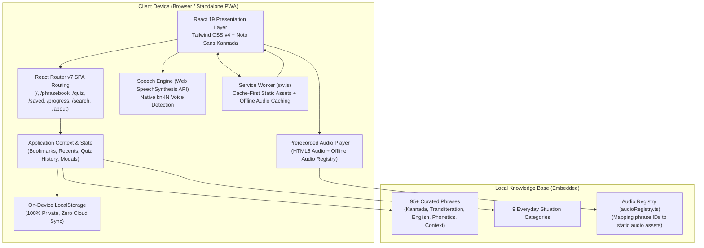

# NammaNudi — Everyday Kannada Companion (ನಮ್ಮನುಡಿ)

> **Learn it. Say it. Use it.**  
> A mobile-first, offline-ready Kannada companion for tourists, students, IT professionals, and non-Kannada speakers navigating daily life across Karnataka.

Built for the **Kannada Digital Innovation Hackathon 2026**  
**Problem Statement:** Problem Statement 3 — *Kannada in Everyday Life*

---

## 📌 Executive Summary

### Problem
Non-Kannada speakers in Karnataka frequently struggle with everyday micro-interactions at bus stands (BMTC/KSRTC), auto stands, Darshini hotels, grocery markets (KR Market), educational campuses, diagnostic clinics, and residential apartments. Generic translation tools often produce stiff, formal sentences, require constant high-speed mobile data, and do not provide an immediate, readable way to communicate with local people on the spot.

### Solution
**NammaNudi** solves this with an offline-first companion application featuring:
1. **9 Real-World Situation Categories** with 95+ verified, authentic, everyday colloquial and polite phrases.
2. **Instant Bilingual Transliteration & Phonetics** so learners know how to pronounce each phrase accurately.
3. **Show-to-Speak Full-Screen Mode:** An ultra-high-contrast, giant-typography card designed specifically to be shown directly to an auto driver, conductor, or shopkeeper.
4. **Browser SpeechSynthesis Integration:** Speech playback with automated Kannada voice detection and graceful fallback.
5. **Interactive Practice Quiz:** 4-option situational quizzes with smart distractors, instant feedback, and streak tracking.
6. **100% Offline-First Architecture:** Cached via Service Worker and Progressive Web App (PWA) manifest; zero backend or paid APIs required.

---

## 🏛️ System Architecture



---

## 🚀 Key Features

### 1. Home Dashboard
- **Brand & Tagline:** Warm Karnataka cultural aesthetic with deep teal, sandalwood ivory, and temple gold accents.
- **Prominent Search Bar:** Jump directly to phrases by keyword (e.g. *auto meter*, *dosa*, *chillare*, *emergency*).
- **Phrase of the Day:** Fresh practical phrase with audio pronunciation, situation badge, and shuffle button.
- **Situation Category Grid:** Quick access to all 9 everyday categories with phrase counts and Kannada titles.
- **Learning Streak & Stats:** Live overview of day streak, quizzes taken, and accuracy percentage.
- **Saved Phrases Carousel:** Instant access to your pinned bookmarks.

### 2. Situation-Based Phrasebook (9 Categories)
Every phrase includes Kannada Unicode script, English translation, Roman transliteration, phonetic breakdown, context note, and formality level (`polite`, `casual`, `formal`).

1. **Travel & Directions (ದಾರಿ ಮತ್ತು ಪ್ರಯಾಣ):** Landmarks, right/left turns, Metro stations, distances.
2. **Public Transport & Buses (ಸಾರಿಗೆ ಮತ್ತು ಬಸ್ ನಿಲ್ದಾಣ):** BMTC bus stops, conductor queries, tickets, auto meter negotiations, UPI payment.
3. **Shopping & Markets (ಖರೀದಿ ಮತ್ತು ಮಾರುಕಟ್ಟೆ):** Bargaining, asking prices, vegetable stalls, UPI QR codes.
4. **Food & Restaurants (ಆಹಾರ ಮತ್ತು ಹೋಟೆಲ್):** Darshini orders (masala dose, filter coffee), spice levels, bills, handwash, takeaways.
5. **Healthcare & Medical (ಆರೋಗ್ಯ ಮತ್ತು ಆಸ್ಪತ್ರೆ):** Describing symptoms, fever, pharmacy medication schedules, clinic appointments.
6. **Emergencies (ತುರ್ತು ಪರಿಸ್ಥಿತಿ):** 112 distress calls, lost phones/wallets, accident alerts, urgent assistance.
7. **Education & Campus (ಶಿಕ್ಷಣ ಮತ್ತು ಕಾಲೇಜು):** Professor cabins, lecture timetables, library hours, xerox notes, classmate banter.
8. **Workplace & Office (ಕಚೇರಿ ಮತ್ತು ಕೆಲಸ):** Greetings, meeting schedules, lunch invites, casual leave requests, wrap-up.
9. **Accommodation & Daily Needs (ವಸತಿ ಮತ್ತು ದೈನಂದಿನ ಅಗತ್ಯಗಳು):** House rent, plumber/leak repairs, BBMP garbage trucks, domestic help, 20L water cans.

### 3. "Show-to-Speak" Full-Screen Mode
- Built for real-world encounters on noisy streets or crowded buses.
- Renders giant, high-contrast Kannada text readable from 2 meters away.
- One-tap audio speech button with visual waveform feedback.
- Accessible previous/next swipe buttons for active conversation flow.

### 4. Client-Side Instant Search
- Real-time client-side search across Kannada script, English meaning, phonetic transliteration, situation tags, and categories.
- Quick search recommendation pills.
- Empty states and clear search shortcuts.

### 5. Practice Quiz & Streaks
- Multiple-choice quiz engine with dynamic randomized questions.
- Tests English-to-Kannada and Kannada/Situation-to-English.
- Contextual explanations for every answer.
- Streak tracking and local score logging.

### 6. Local-First Progress & Privacy
- Tracks quizzes completed, accuracy %, categories mastered, and starred phrases.
- **100% on-device:** Persisted in browser `localStorage`. No accounts, tracking, or cloud sync needed.
- Complete user control with a "Reset Progress" option.

### 7. Pronunciation Practice / Repeat-After-Me Mode
- **Six-Step Pedagogical Flow:** *Listen → Understand → Repeat → Record → Replay → Practise Again*.
- **In-Memory Audio Capture:** Powered by the HTML5 `MediaRecorder` API with dynamic MIME type negotiation (`audio/webm;codecs=opus`, `audio/mp4`, `audio/aac`).
- **100% In-Browser Privacy:** Recorded voice is kept strictly in temporary device RAM as an in-memory Blob. Audio is **never uploaded** to any server or cloud.
- **Immediate Hardware Release:** MediaStream tracks are explicitly stopped immediately when recording finishes, cleanly turning off device microphone indicator lights.
- **Side-by-Side Self-Assessment:** Allows immediate alternating playback between the authentic reference pronunciation and the learner's recorded voice with honest linguistic checkpoints (vowel length, rhythm, polite endings).
- **Device Capability Diagnostics:** Built-in capability inspector clearly reports Secure Context, `getUserMedia`, `MediaRecorder`, and audio codecs on mobile and desktop.

---

## 🛠️ Technology Stack

| Technology | Purpose |
|---|---|
| **React 19** | Declarative component UI library |
| **TypeScript 6** | Strict type safety and compile-time correctness |
| **Vite 8** | High-performance bundler and development server |
| **Tailwind CSS v4** | Modern utility-first styling with custom typography |
| **React Router v7** | Client-side routing (`/phrasebook`, `/quiz`, `/saved`, `/progress`, `/search`, `/about`) |
| **Lucide React** | Clean, modern vector iconography |
| **Web SpeechSynthesis API** | Native text-to-speech with Kannada voice detection and fallback |
| **Service Worker & PWA** | Offline app shell caching, background asset caching, and standalone installation |
| **LocalStorage** | Persistence of favorites, recents, quiz scores, and streak |

---

## 💻 Local Setup & Run Instructions

### Prerequisites
- Node.js (version 18+ or 20+)
- npm or pnpm

### Installation
```bash
# 1. Clone or navigate into the project directory
git clone https://github.com/<your-username>/NammaNudi.git
cd NammaNudi

# 2. Install dependencies
npm install

# 3. Start development server
npm run dev
```

The application will be available at: `http://localhost:5173`

---

## 📦 Production Build

```bash
# Typecheck and build optimized static assets
npm run build

# Preview production build locally
npm run preview
```

Static assets are compiled into the `dist/` directory.

---

## 🌐 Deployment Instructions (Vercel)

NammaNudi is configured for deployment on **Vercel** with SPA client-side routing and PWA headers pre-configured in `vercel.json`.

### Option A: Via Vercel CLI
```bash
# Install Vercel CLI globally (if not installed)
npm install -g vercel

# Deploy
vercel --prod
```

### Option B: Via Vercel Web Dashboard
1. Push your repository to GitHub.
2. In the Vercel dashboard, click **"Add New Project"** and import the `NammaNudi` repository.
3. Keep default settings:
   - **Framework Preset:** Vite
   - **Build Command:** `npm run build`
   - **Output Directory:** `dist`
4. Click **Deploy**.

### SPA Routing & Service Worker Headers on Vercel
The included [`vercel.json`](file:///c:/Users/Sahim%20Sha/Desktop/Projects/NammaNudi/vercel.json) automatically ensures:
- All client-side routes (`/phrasebook`, `/quiz`, `/saved`, etc.) rewrite to `/index.html` on direct visit or refresh.
- `sw.js` and `manifest.webmanifest` are served with `Cache-Control: public, max-age=0, must-revalidate` so updates deploy cleanly to user devices.

---

## 🔒 Security, Credentials & HTTPS

- **Zero Secrets / Zero API Keys:** The application requires no external backend, API keys, database credentials, or paid third-party tokens.
- **HTTPS Enforcement:** When deployed to production (e.g. Vercel, Netlify, Cloudflare), all connections use HTTPS. Service Workers and PWA install capabilities strictly enforce secure HTTPS contexts (with localhost supported for local testing).
- **No Personal Data Collected:** User bookmarks, recents, and quiz streaks remain entirely on the user's client device in `localStorage`.

---

## 📴 Offline Capability & Honest Voice Disclosure

### How Offline Works
1. **Initial Visit:** On your first online visit, the Service Worker registers and caches the core app shell (`index.html`, stylesheets, scripts, icons).
2. **Phrase Database:** All 95+ phrases and 9 categories are bundled directly in the client bundle—**no network requests** are required to read, search, or practice phrases.
3. **Storage:** All bookmarks, quiz history, and streaks are stored locally in the browser's `localStorage`.
4. **PWA Standalone:** Users can install NammaNudi on Android or iOS ("Add to Home Screen") to launch it like an app even without cellular connectivity.

### Multi-Tier Audio Strategy & Voice Disclosure
1. **Tier 1 — Native Browser Kannada TTS:**
   - Evaluates system voices using `speechSynthesis.getVoices()` for `kn-IN` or `kn` language tags.
   - Sets utterance script directly to authentic Kannada text.
   - Standard on Android devices with Google Text-to-Speech language pack installed.
2. **Tier 2 — Offline Prerecorded Audio Fallback:**
   - If device TTS lacks a Kannada voice (standard on Windows/macOS where Kannada language pack only provides typing/handwriting, not a TTS speech engine), the app attempts to play authentic human audio files cached in `public/audio/<phraseId>.mp3`.
   - Audio files are registered in `src/data/audioRegistry.ts` and managed by `src/utils/audioPlayer.ts`.
3. **Tier 3 — Syllable Phonetics & Show-to-Speak:**
   - If neither native TTS nor a prerecorded audio file exists for a phrase, NammaNudi **never fabricates audio playback** or substitutes English speech.
   - It alerts the user with an honest, gentle notification, presents the phonetic syllable breakdown (e.g. `[yis-h-TOO A-yee-THU?]`), and encourages using the full-screen **Show-to-Speak** display to communicate on the spot.

### Phrase Data Integrity & Dialect Transparency
- All 95+ phrases reflect contemporary, polite, real-world spoken Kannada in Bengaluru and urban Karnataka.
- Everyday expressions with strong regional dialectal variance (e.g., North Karnataka / Hubballi vs Karavali / Coastal) are explicitly noted in context notes and tagged for ongoing native-speaker peer review, rather than falsely claiming universal external academic certification.

---

## 🔮 Future Enhancements (Post-MVP Roadmap)

1. **Expanding Human Audio Library:** Record and drop additional compressed audio clips into `public/audio/<phraseId>.mp3` using the ready fallback infrastructure.
2. **AI Voice Pronunciation Scoring:** Browser WebAudio / WebAssembly acoustic scoring to rate pronunciation accuracy.
3. **Kannada Script Practice:** Canvas-based stroke recognition for learning basic Kannada alphabet (Aksharamale).
4. **Contextual Geofencing:** Suggesting bus phrases when near BMTC bus stands or Darshini phrases during meal times.
5. **Community Submissions:** Verified crowdsourcing of regional Kannada dialects.

---

## 📜 License
Developed for the **Kannada Digital Innovation Hackathon 2026**. Open source under the MIT License.
